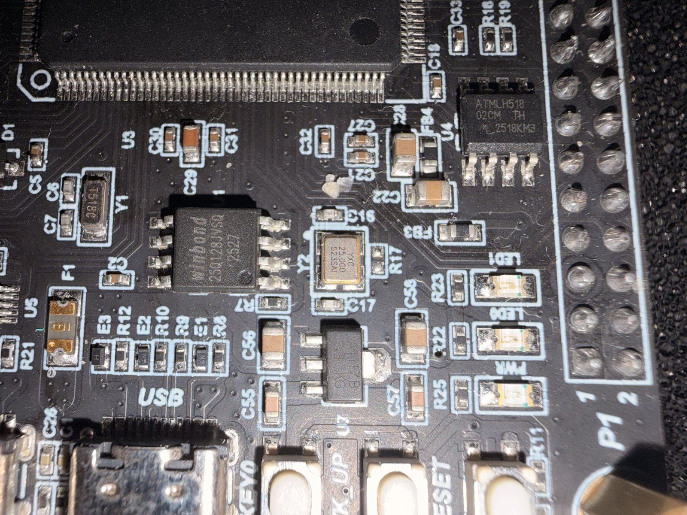
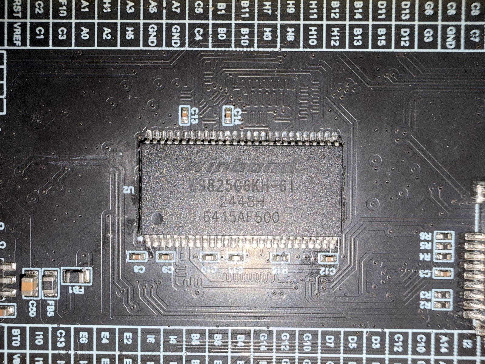
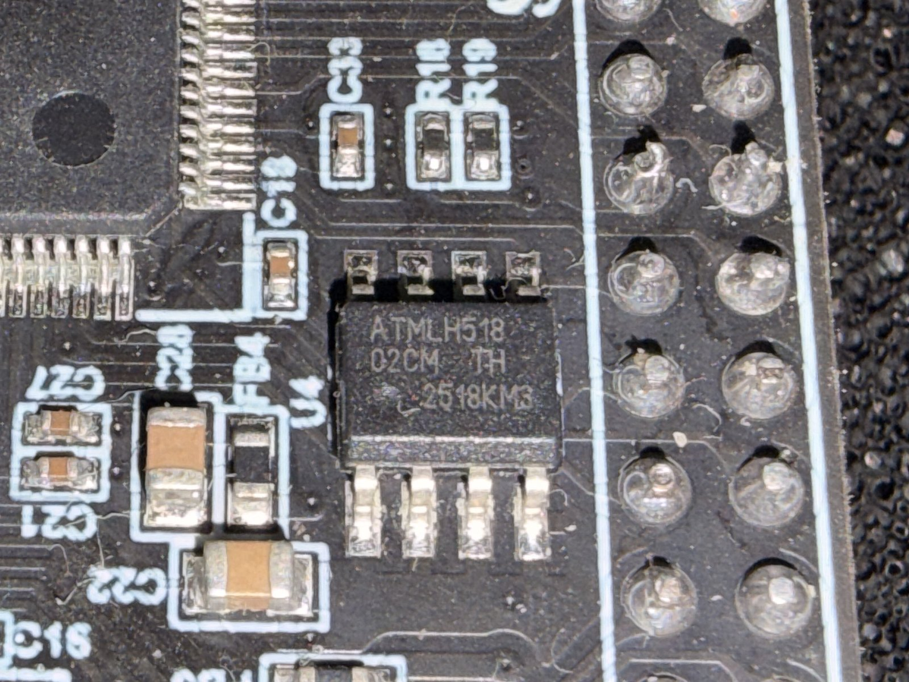
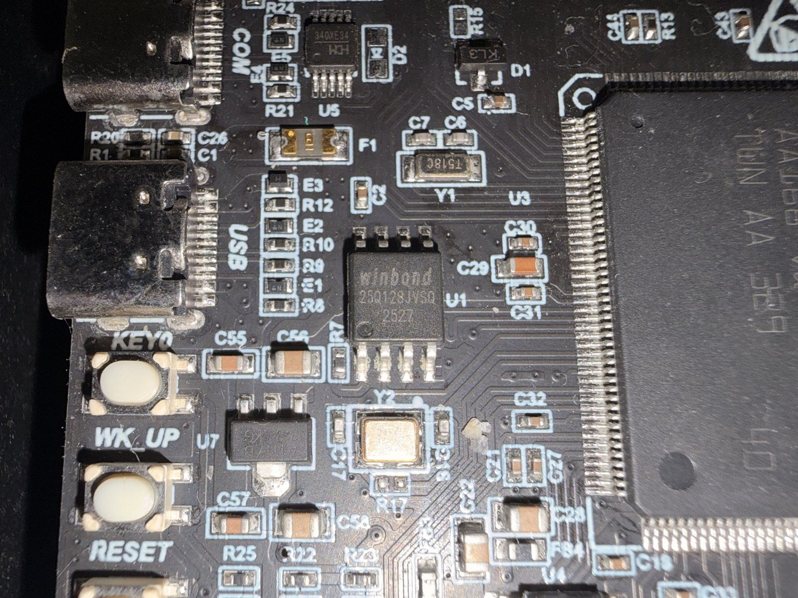

# Peripheral Details

---

## Clocks

- **HSE (Y2):** 25 MHz crystal, YXC, marking `YXC 25.000 523SAI`, load capacitors C16/C17
- **LSE (Y1):** 32.768 kHz crystal (2-pad SMD, marking `T518C`), next to the MCU pin 1 corner
  (PC14/PC15), load capacitors C6/C7

---

## QSPI Flash

- Interface: QUADSPI (Bank 1)
- Part: Winbond W25Q128JV (U1, marking `25Q128JVSQ 2527`)
- Type: NOR Flash
- Density: 128 Mb (16M x 8)
- Protocol support: SPI / Quad I/O / QPI / DTR
- Max clock: 133 MHz
- Package: 8-SOIC (208 mil)

---

## SDRAM

- Interface: FMC (Bank 5 / SDRAM Bank 1)
- Part: Winbond W9825G6KH-6I (U2, marking `W9825G6KH-6I 2448H`)
- Density: 256 Mb (16M x 16), equivalent to 32 MB
- Type: SDR SDRAM (parallel)
- Max clock: 166 MHz (5 ns)
- Organization: 4 banks, 8192 rows, 512 columns
- Refresh: 8192 cycles / 64 ms
- Package: 54-TSOP II

---

## TF Card

- Interface: SDMMC1 (4-bit)
- Card detect pin: not present on this board
- Connector: Micro SD card socket (push-push)

---

## EEPROM

- Interface: I2C2 (SCL: PH4, SDA: PH5)
- Part: Microchip (Atmel) AT24C02C serial EEPROM
- Density: 2 Kbit (256 x 8 bytes)
- Page size: 8 bytes
- Write cycle time: 5 ms max
- I2C address: 0x50 (assumes A0-A2 tied to GND)
- Package: 8-SOIC (U4)
- Top marking observed: `ATMLH518 02CM TH 2518KM3` (ATML = Atmel, H518 = 2025 week 18,
  02C = AT24C02C)
- Datasheet: [AT24C02C](https://www.microchip.com/en-us/product/at24c02c)

---

## USB

- Mode: USB Full Speed (Device or OTG)
- Connector: USB-C

---

## COM Ports

- **USART1** (PA9/PA10) is routed to a USB-to-UART bridge (WCH CH340X, U5, MSOP-10, marking `340X...`)
- Connector type for this serial port: USB-C
- Field note: the USB-UART path was pulling MCU `NRST` low when a serial monitor connected; after removing the diode in that reset coupling path, behavior normalized

---

## LEDs

Two active-low LEDs controlled via GPIO output.

- **LED0 (PB0):** red, active low
- **LED1 (PB1):** green, active low
- **PWR LED:** red, tied to power rail (always on when powered)

---

## Keys / Buttons

- **WK_UP (PA0):** active high, can be used as wake-up source from low-power modes
- **KEY0 (PA1):** active high
- **RESET button:** active low, with a capacitor in parallel

---

## LCD1 — RGB Interface 

- Interface: RGB parallel (likely 16-bit or 24-bit)
- Status: still pending detailed characterization; pin-level mapping and exact panel standard need to be documented.

---

## LCD2 — SPI Interface 

- Interface: SPI
- Status: still pending detailed characterization; pin-level mapping and exact panel standard need to be documented.

---

## Camera (DVP) 

- Interface: DCMI (parallel digital camera interface)
- Status: still pending detailed characterization; sensor standard and full pin mapping need to be documented.

---

## GPIO Expansion Header

A header breaks out additional GPIO pins for user expansion. Exact pins to be documented.

---

## SWD

Standard 4-pin SWD debug interface:

| Pin | Signal |
|-----|--------|
| 1 | VCC (3.3V) |
| 2 | SWDIO (PA13) |
| 3 | SWCLK (PA14) |
| 4 | GND |

Compatible with ST-Link V2, J-Link, and similar debuggers.

---

## Power

- Input voltage: not confirmed — likely 5V via USB or header
- On-board 3.3V regulator for MCU and peripherals: 1117-type 3.3 V LDO (U7, SOT-223, marking
  `A1117B 3.3 KG`)
- USB input protected by a resettable fuse (F1)

